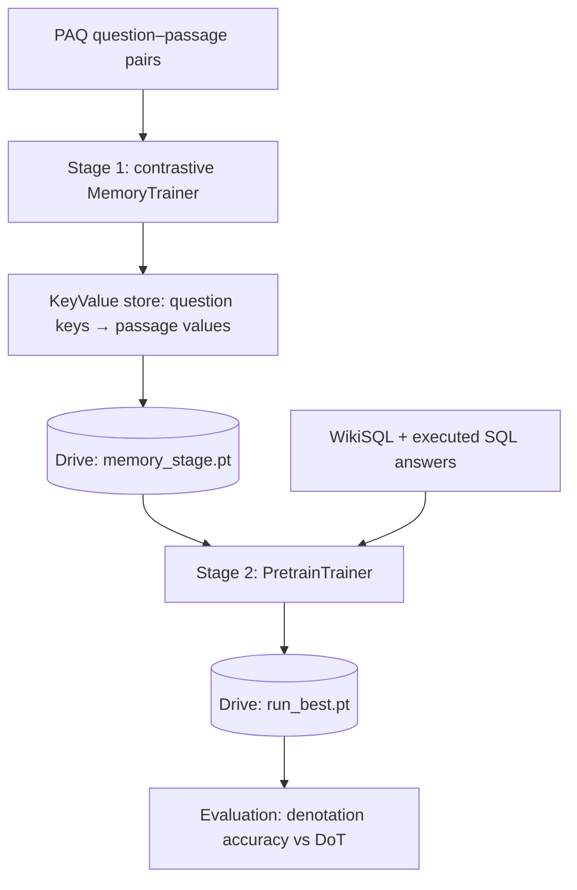

# ECE-570 Project — DoT Model Implementation — TableMind

[](https://www.python.org/downloads/)
[](https://pytorch.org/)
[](https://huggingface.co/transformers/)

A reimplementation of DoT (Double Transformer, [Krichene et al., 2021](https://arxiv.org/abs/2106.00479)) for table question answering. DoT's second, large TAPAS is replaced by a **T5** task model, and the model is extended with an external **key-value memory**. Training runs in two stages through three Colab-ready notebooks.

## 🎯 Project Overview

- **Pruning transformer (TAPAS-small):** scores every token of the 1024-token flattened table and question. Whole cells are kept, highest mean score first, until 256 tokens are used. The question and header row are always kept. This follows DoT's small → 256 → large setup, with cells instead of single tokens.
- **Task transformer (T5):** the kept TAPAS tokens are decoded back to text and re-tokenized for T5. Each kept cell's embeddings are scaled by `sigmoid(cell score)`, so the pruner is trained end to end through the T5 loss.
- **Key-value memory:** a T5 memory encoder, trained contrastively on PAQ question–passage pairs, fills a store with two kinds of entries: PAQ question → passage, and WikiSQL *training* question → query pattern (e.g. "count school / club team where player", never the answer). During training an example never retrieves its own entry. The task transformer mixes the top-k retrieved values through a gate that starts at zero (trained at 10× the learning rate). Memory can be switched off (`use_memory: false`) for an ablation.
- **Gold answers:** WikiSQL ships SQL queries, not answers. Each query is executed on WikiSQL's **official SQLite databases** with the semantics of the official evaluator, so gold answers match the benchmark exactly. Questions whose gold answer is empty (8% of the test set) are kept: the model learns to answer nothing.
- **Aggregation targets:** for COUNT/SUM/AVG/MAX/MIN, T5 generates the operator and the selected cells (`count: a | b | c`) and the aggregate is computed in Python, instead of T5 generating the number. Computing from the gold cells reproduces 99.97% of official answers.
- **Metric:** **denotation accuracy**, the metric DoT reports, over the full test set (answerable-only accuracy is reported too). The epoch with the best validation denotation accuracy is kept.

## 📁 Repository Structure

```
.
├── src/
│   ├── notebooks/
│   │   ├── 01_memory.ipynb      # Stage 1: contrastive memory training + fill the store
│   │   ├── 02_pretrain.ipynb    # Stage 2: DoT training on WikiSQL
│   │   └── 03_evaluation.ipynb  # Test split: denotation accuracy, comparison with DoT
│   ├── config/
│   │   └── default.yaml         # the experiment configuration
│   ├── core/
│   │   ├── memory/
│   │   │   ├── encoder.py       # MemoryEncoder
│   │   │   └── store.py         # KeyValueMemoryStore
│   │   ├── model/
│   │   │   ├── pruning.py       # PruningTransformer (TAPAS)
│   │   │   ├── task.py          # TaskTransformer (memory-augmented T5)
│   │   │   └── dot.py           # DoTModel (cell pruning → re-tokenize → generate)
│   │   └── training/
│   │       ├── base.py              # BaseTrainer (shared optimisation loop)
│   │       ├── memory_trainer.py    # MemoryTrainer (stage 1)
│   │       └── pretrain_trainer.py  # PretrainTrainer (stage 2)
│   └── utils/
│       ├── paq.py               # PAQDataset (streamed question–passage pairs)
│       ├── wikisql.py           # WikiSQLDataset (official release, executed answers)
│       ├── sql.py               # WikiSQL query executor
│       ├── metrics.py           # denotation accuracy and exact match
│       ├── checkpoint.py        # save / load / upload / download checkpoints
│       └── helpers.py           # config loading, seeding, collation, run names
└── requirements.txt
```

## 🚀 Running on Google Colab

Run the notebooks in order. Each opens with an **Open in Colab** badge, and its first cell clones this repository and installs the requirements.

1. **[01_memory.ipynb](src/notebooks/01_memory.ipynb):** trains the memory encoder, fills the store, and uploads `memory_stage.pt`. Run it once; every pretraining run reuses it.
2. **[02_pretrain.ipynb](src/notebooks/02_pretrain.ipynb):** loads the memory stage and trains DoT on the full WikiSQL training set. After each epoch it scores validation denotation accuracy and saves the best epoch as `<run>_best.pt` (plus `<run>_final.pt` at the end).
3. **[03_evaluation.ipynb](src/notebooks/03_evaluation.ipynb):** scores `<run>_best.pt` on the full test split (denotation accuracy on all and on answerable examples, exact match, per-aggregation breakdown). It uploads `<run>_results.json` and compares this experiment's runs with the DoT paper.

Use **Runtime → Change runtime type → A100 GPU** (or L4). The t5-large task model needs a GPU with at least 24 GB; it does not fit a T4.

**Disconnects and resuming.** Colab ends idle sessions, caps session length, and deletes the VM when a session ends. Training in notebooks 1 and 2 therefore saves a resumable checkpoint (weights, optimizer, scheduler, RNG states, epoch and position within the epoch) every 10 minutes (`system.checkpoint_minutes`) and after every epoch, and uploads it to Drive in the background. After a disconnect, reconnect and choose **Runtime → Run all**: the notebook finds the checkpoint and continues where it stopped, losing at most ~10 minutes. Keep at least 30 GB free in Google Drive while a run is in progress (see Performance Notes). Checkpoints pass between notebooks through Google Drive (`MyDrive/TableMind/checkpoints`); you'll be asked to authorize Drive once per session. The notebooks clone the GitHub repository, so push your changes before running them on Colab.

### Experiment protocol
DoT reports the **median of 3 runs**. Notebooks 2 and 3 share a *Run settings* cell:

```python
SEED = 42          # repeat with 43 and 44
USE_MEMORY = True  # False = ablation without memory retrieval
```

Each combination is a separate run, named for example `dot_t5_memory_seed42` or `dot_t5_memory_no_memory_seed43`, so checkpoints never overwrite each other. For the full comparison, train and evaluate all 6 runs (3 seeds × memory on/off). The last cell of `03_evaluation.ipynb` then shows the median per setting next to the paper's numbers:

| Model (WikiSQL test, denotation accuracy) | Paper |
|---|---|
| TAPAS large, 512 tokens | 83.6 |
| TAPAS large, 1024 tokens | 86.0 |
| DoT small → 256 → large (HEM) | 85.3 |
| DoT medium → 256 → large (HEM) | 85.5 |

## 💻 Running Locally

```powershell
python -m venv .venv
.venv\Scripts\Activate.ps1
pip install -r requirements.txt
pip install jupyter
jupyter notebook src/notebooks/
```

Outside Colab, the notebooks switch to the repository root and use `./storage` instead of Google Drive. WikiSQL is downloaded once to `~/.cache/tablemind`; set `TABLEMIND_CACHE` to change that location.

## ⚙️ Configuration

`src/config/default.yaml` is the single configuration:

| Setting | Value | DoT paper |
|---|---|---|
| Pruning transformer | `google/tapas-small-finetuned-wtq` (4 layers) | TAPAS small or medium |
| Input → kept tokens | 1024 → 256 (whole cells) | 1024 → 256 (tokens) |
| Task transformer | `t5-large` (24+24 layers) + key-value memory, bf16, gradient checkpointing | TAPAS large (24 layers) |
| Training data | full WikiSQL train set, 3 epochs (~21k steps, batch size 8) | full train set, 50k steps |
| Evaluation | full test set, denotation accuracy, 3 seeds | same |

t5-large is trained with gradient checkpointing and bf16 autocast to fit a 24–40 GB GPU (A100 or L4 on Colab Pro). The first experiment (`dot_t5_memory`, t5-base) reached 81.3% denotation accuracy on the answerable test examples; see the git history of `03_evaluation.ipynb`.

| Section | Used by | Key settings |
|---|---|---|
| `model` | all stages | model names, `proj_dim`, pruning `top_k`, T5 input `max_length`, `use_memory` |
| `data.paq` | stage 1 | `num_examples` (streamed), question/passage lengths, `eval_ratio` |
| `data.wikisql` | stages 2–3 | split names and subset ratios, TAPAS `max_length`, `answer_max_length` |
| `memory_training` | stage 1 | batch size (in-batch negatives), learning rate, `temperature` |
| `pretraining` | stage 2 | epochs, learning rate, scheduler, gradient accumulation, `memory_top_k` |
| `storage` | all stages | Drive folder and memory checkpoint name |

## 🏗️ Training Pipeline



Inside `DoTModel.forward`:

1. TAPAS scores each token with its cell-selection head (before temperature scaling and column masking, which would saturate the sigmoid). Each cell's score is the mean of its tokens' scores.
2. The question and header row are kept; body cells are added whole, highest score first, while they fit in the 256-token budget. Padding is never selected and the original order is preserved.
3. The kept word pieces are merged into words, with `header:` / `row:` / `;` markers, and re-tokenized with the T5 tokenizer.
4. Each body cell's T5 embeddings are scaled by `sigmoid(cell score)`. T5 encodes the result, adds the table embedding and the retrieved memory, and decodes the answer. Multi-row answers are separated by ` | `; aggregations are generated as `operator: cells` and computed in Python.

## 📈 Performance Notes

- Training uses t5-large (task model), t5-base (memory encoder) and tapas-small at batch size 8: about 880M parameters, so weights, gradients and AdamW state alone take about 14 GB, plus activations (estimate: ~18 GB in total with gradient checkpointing and bf16). Use an A100 or L4; if memory runs out, set `pretraining.batch_size: 4` and `gradient_accumulation_steps: 2`.
- One epoch over the full training set is about 7,000 optimizer steps, and each epoch ends with a generation pass over the validation set to pick the best epoch. Plan the 6 runs (3 seeds × memory on/off) within your compute units; run seed 42 with and without memory first. Colab Pro still has idle timeouts and session limits; the 10-minute resumable checkpoints make that safe.
- Checkpoint sizes with t5-large: `<run>_best.pt` and `<run>_final.pt` are about 3.7 GB each (weights + memory store); the resumable `<run>_resume.pt` also holds AdamW state, about 10.5 GB, and an upload briefly needs room for a second copy. Plan for roughly 30 GB of Google Drive space per run in progress (a 100 GB Google One plan is enough); delete `<run>_resume.pt` once a run has finished.

## 🐛 Troubleshooting

- **`FileNotFoundError: ... run the previous stage's notebook first`:** the checkpoint isn't in the Drive folder. Run the notebooks in order, with the same `SEED` and `USE_MEMORY` in notebooks 2 and 3.
- **CUDA device-side assert:** after one, the GPU context is unusable. Use **Runtime → Disconnect and delete runtime** before re-running.
- **Model download issues:** set `HF_HOME=/path/to/large/disk`, or `HF_HUB_OFFLINE=1` once the models are cached.

## 📝 License & Citation

This project is developed for **ECE-570: Introduction to AI** coursework.

```bibtex
@misc{dot_model_2024,
  title={DoT Model Implementation for Table Question Answering},
  author={ECE-570 Project Team},
  year={2024},
  institution={Purdue University}
}
```

## 🔗 References

- [DoT: An Efficient Double Transformer for NLP Tasks with Tables](https://arxiv.org/abs/2106.00479) - Original DoT paper
- [Transformers Library](https://huggingface.co/transformers/)
- [TAPAS Paper](https://arxiv.org/abs/2004.02349)
- [T5 Paper](https://arxiv.org/abs/1910.10683)
- [WikiSQL Dataset](https://github.com/salesforce/WikiSQL)
- [PAQ: 65 Million Probably-Asked Questions](https://arxiv.org/abs/2102.07033)
